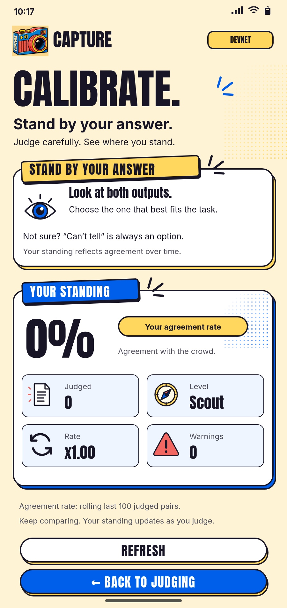
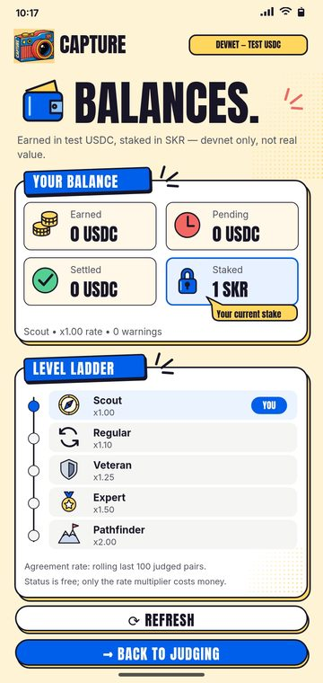
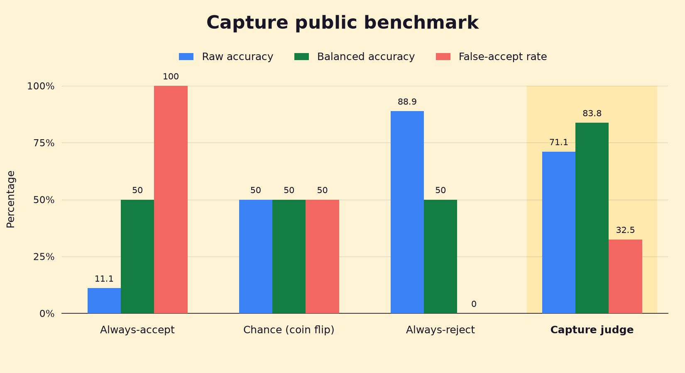

# Capture: Decentralized RLHF

Humans review a vision model's outputs. Consensus decides who gets paid. A slashable stake prices every review.

**Capture** is a mobile RLHF preference-review network. A reviewer sees two
vision-model outputs and picks the better one (A/B preference) or rates a
single output 1–5. Aggregated preferences form an RLHF preference dataset,
with trust priced into every review through a slashable $SKR bond.

Live on **Solana devnet** with test tokens: no production money, no production claims.

## How it works

**Onboard → Stake → Review → Settle.**

1. **Onboard.** Complete a liveness check, then pass 10 known-consensus pairs before you can stake or earn.
2. **Stake.** Stake $SKR to unlock paid reviewing. Your stake is the collateral at risk if you farm.
3. **Review.** Pick the better of two outputs, or rate one 1–5. "Can't tell" is always allowed and never penalized.
4. **Settle.** Three reviewers see each pair; the 2/3 majority pick wins. Agree and earn USDC; dissent earns nothing; farming is warned, then slashed.

Your agreement rate drives your level and payout multiplier, from Scout through Pathfinder.

See the full flow at [capture.fun/how-it-works.html](https://capture.fun/how-it-works.html).

## Screenshots

  

  
  

## Architecture

Android client → scoring API (calibration, three-reviewer consensus, accuracy ladder) → Solana settlement ($SKR bond escrow, warn/slash, treasury). A Merkle anchor commits each resolved batch on-chain.

## Benchmark

> **Status: preliminary.** n=45 total, n=5 accept-class samples. This run
> establishes that the judge beats a naive baseline, but the positive sample is
> too small to report a precise number. Treat the balanced-accuracy figure as
> directional.

Capture routes every submission through a vision quality-judge that returns an
accept/reject verdict against the capture spec (ground-level framing, real
photo, no watermark, sharpness, exposure). This benchmark answers one question:
does the judge classify better than a naive baseline?

**Evaluation date:** 2026-10-12 · **Dataset:** 45 labeled samples across 9
capture-spec classes (40 rejects, 5 accepts).

We score the judge's verdicts against fixed ground-truth labels and compare
against three model-free baselines:

- **Always-accept** — accepts every submission.
- **Chance** — a coin-flip accept/reject decision.
- **Always-reject** — rejects every submission.

The labeled set is reject-heavy, so raw accuracy alone is misleading:
"always-reject" scores 88.9% while accepting nothing real. We report raw
accuracy, **balanced accuracy** (the mean of accept-recall and reject-recall),
and the **false-accept rate** (the share of bad submissions that leak through).

| Method | Raw accuracy | Balanced accuracy | False-accept rate |
|---|---|---|---|
| Always-accept | 11.1% | 50.0% | 100% |
| Chance (coin flip) | 50.0% | 50.0% | ~50% |
| Always-reject | 88.9% | 50.0% | 0% |
| **Capture judge** | **71.1%** | **83.8%** | **32.5%** |

### Confusion matrix (judge)

| | Predicted accept | Predicted reject |
|---|---|---|
| Actually good (5) | 5 | 0 |
| Actually bad (40) | 13 | 27 |

### What this shows

The judge clears the 50% chance baseline on balanced accuracy (83.8%) and never
rejects a good submission (accept-recall 100%). It also lets 32.5% of bad
submissions through — about one in three. The false-accept rate is the judge's
weakness right now.

### Reference-free IQA baselines

A single no-reference image-quality score is the natural "rule-based" bar — it
measures blur, noise, and exposure without training, so it tests whether the
judge is just re-encoding raw image quality. We scored all 45 samples with
BRISQUE, NIQE, and MUSIQ (KonIQ-10k) through `pyiqa`, and measured how well each
separates accepted from rejected submissions (ROC-AUC, threshold-free):

| Metric | ROC-AUC (accept vs reject) |
|---|---|
| BRISQUE | 0.64 |
| NIQE | 0.78 |
| MUSIQ (KonIQ-10k) | 0.83 |

A quality score gets partway there — MUSIQ ranks an accepted image above a
rejected one ~83% of the time — but it misses the semantic criteria: a
watermarked or wrong-perspective submission can be technically clean. That gap
is what the judge adds beyond raw quality. Like the headline number, these are
descriptive on a 45-sample set, not a precise estimate of generalization.

### Precision

With only 5 accept-class samples, the headline number is imprecise.
Clopper–Pearson 95% confidence intervals:

- accept-recall (5/5): **47.8%–100%**
- reject-recall (27/40): **50.9%–81.4%**
- false-accept rate (13/40): **18.6%–49.1%**

The balanced-accuracy estimate therefore sits in an approximate range of
**49%–91%** — at the low end, indistinguishable from chance.

### Limitations

1. **Tiny positive class (n=5).** One misclassified good submission swings
   balanced accuracy ~10 points. The accept class needs to grow 20–50×.
2. **No per-class breakdown.** The 9 classes are reported as one aggregate.
3. **Single-annotator ground truth** — no recorded inter-annotator agreement,
   notable for a product whose thesis is human agreement.
4. **Weak baselines.** Reference-free IQA (BRISQUE/NIQE/MUSIQ) is now reported, but there is no tuned rule-based classifier (the real bar) yet.
5. **Label mix may not match production** (an 89% reject rate may not reflect
   real traffic).

### Path to a stronger benchmark

1. Grow the accept class to ≥100 (ideally 200+) samples.
2. Add a rule-based baseline — BRISQUE/NIQE/MUSIQ are now reported, but a tuned rule-based classifier (watermark, sharpness/Laplacian, exposure, framing) is still missing.
3. Add 2–3-annotator labeling with reported agreement (Cohen's κ).
4. Report per-class accuracy.
5. Target a false-accept rate ≤10% (currently 32.5%).

All tokens referenced are test tokens on Solana devnet.

## Safety benchmark

> **Status: preliminary.** Gold labels are model-authored, not human-verified.

**Evaluation date:** 2026-11-24 · **Eval set:** 110 adversarial scenarios across
five safety categories (fine-tuned on 2,000 examples).

A separate content-safety classifier flags unsafe responses across five
categories (endearment, hostility, promises, fabricated statements, invented
experiences). Fine-tuning on 2,000 examples turns an out-of-distribution
baseline that flagged nearly everything into a practical gate. On a
110-scenario adversarial hold-out:

| Metric | Baseline | Fine-tuned |
|---|---|---|
| Recall | 0.759 | 0.830 |
| False-positive rate | 0.713 | 0.148 |
| Balanced accuracy | 0.523 | 0.841 |

Full per-rule breakdown, the method, and the reproducible eval set live in
[safety.md](safety.md) and [safety-eval.jsonl](safety-eval.jsonl).

### Word-level gate

A deterministic word-level gate blocks prohibited words outright, as a second
layer behind the classifier. Benchmarked across a 2,000-example adversarial set
(direct, reworded, and obfuscated spellings), its detection improved from 27.5%
to 98%, with zero false positives.

## Test suite (measured 2026-10-29)

Backend 212 passed / 10 skipped · Rust 15 · Android 67.

## Honest lines

- Test $SKR and USDC on devnet: no production money, no production claims.
- Majority-preference bias is real: RLHF on majority preference flattens minority views.
- 18+, self-attested: not a cryptographic proof of age.
- Built for Android.

## Links

- [capture.fun](https://capture.fun): live product site
- [Safety benchmark](safety.md): content-safety classifier before/after (in this repo)
- [Terms](https://capture.fun/terms.html) · [Privacy](https://capture.fun/privacy.html)
