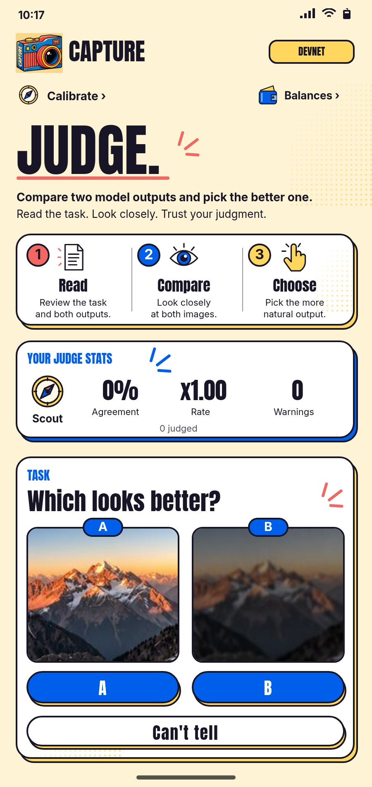
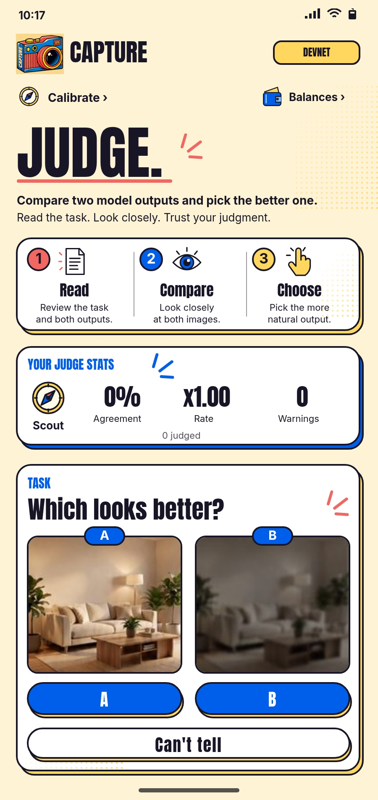
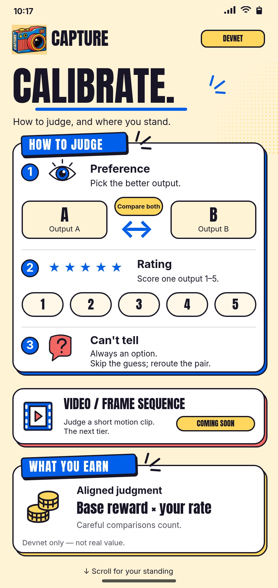
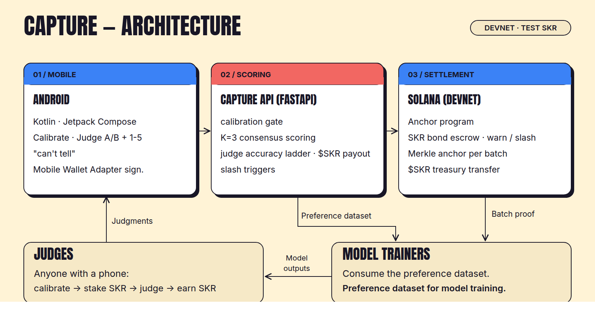
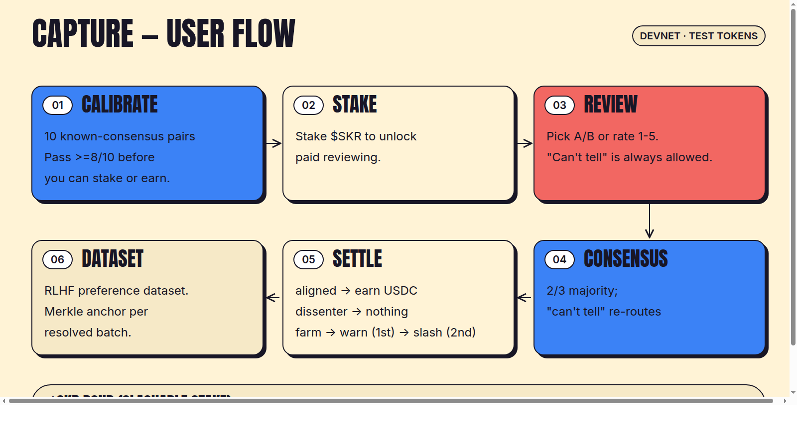

# Capture: Decentralized RLHF

Humans review a vision model's outputs. Consensus decides who gets paid. A slashable stake prices every review.

**Capture** is a mobile RLHF preference-review network. A reviewer sees two
vision-model outputs and picks the better one (A/B preference) or rates a
single output 1–5. Aggregated preferences form an RLHF preference dataset,
with trust priced into every review through a slashable $SKR bond.

Live on **Solana devnet** with test tokens: no production money, no production claims.

## How it works

**Onboard → Stake → Review → Settle.**

1. **Onboard.** Complete a liveness check, then pass 10 known-consensus pairs before you can stake or earn.
2. **Stake.** Stake $SKR to unlock paid reviewing. Your stake is the collateral at risk if you farm.
3. **Review.** Pick the better of two outputs, or rate one 1–5. "Can't tell" is always allowed and never penalized.
4. **Settle.** Three reviewers see each pair; the 2/3 majority pick wins. Agree and earn USDC; dissent earns nothing; farming is warned, then slashed.

Your agreement rate drives your level and payout multiplier, from Scout through Pathfinder.

See the full flow at [capture.fun/how-it-works.html](https://capture.fun/how-it-works.html).

## Screenshots

  
  
  
  
  

## Architecture

Android client → scoring API (calibration, three-reviewer consensus, accuracy ladder) → Solana settlement ($SKR bond escrow, warn/slash, treasury). A Merkle anchor commits each resolved batch on-chain.

## Benchmark

Capture routes every submission through a vision quality-judge that returns an
accept/reject verdict against the capture spec (ground-level framing, real
photo, no watermark, sharpness, exposure). This benchmark answers one question:
does the judge classify better than a naive baseline?

**Evaluation date:** 2026-10-12 · **Dataset:** 45 labeled samples across 9
capture-spec classes (40 rejects, 5 accepts).

We score the judge's verdicts against fixed ground-truth labels and compare
against three model-free baselines:

- **Always-accept** — accepts every submission.
- **Chance** — a coin-flip accept/reject decision.
- **Always-reject** — rejects every submission.

The labeled set is reject-heavy, so raw accuracy alone is misleading:
"always-reject" scores 88.9% while accepting nothing real. We report both raw
and balanced accuracy (the mean of accept-recall and reject-recall), the
standard metric for an imbalanced accept/reject task.

| Method | Raw accuracy | Balanced accuracy |
|---|---|---|
| Always-accept | 11.1% | 50.0% |
| Chance (coin flip) | 50.0% | 50.0% |
| Always-reject | 88.9% | 50.0% |
| **Capture judge** | **71.1%** | **83.8%** |

The judge is the only method that clears the 50% chance baseline on balanced
accuracy, scoring **83.8%**: it accepts all five real submissions and rejects
the majority of bad ones, where a naive baseline accepts everything or nothing.

All tokens referenced are test tokens on Solana devnet.

## Test suite (measured 2026-10-29)

Backend 212 passed / 10 skipped · Rust 15 · Android 67.

## Honest lines

- Test $SKR and USDC on devnet: no production money, no production claims.
- Majority-preference bias is real: RLHF on majority preference flattens minority views.
- 18+, self-attested: not a cryptographic proof of age.
- Built for Android.

## Links

- [capture.fun](https://capture.fun): live product site
- [Terms](https://capture.fun/terms.html) · [Privacy](https://capture.fun/privacy.html)
