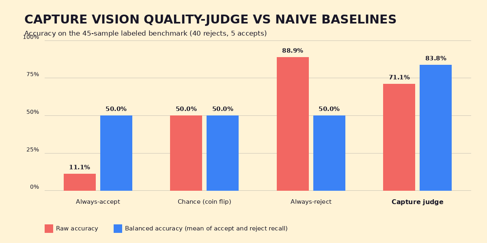

# Capture: Vision Quality-Judge Evaluation

**Evaluation date:** 2026-10-12. **Dataset:** 45 labeled samples across 9 capture-spec classes, 5 per class (40 rejects, 5 accepts).

## Methodology: what this measures

Capture routes every submission through a vision quality-judge that returns an accept or reject verdict against the capture spec (ground-level framing, real photo, no watermark, sharpness, exposure). This benchmark answers one question: does the judge classify better than a naive baseline?

We score the judge's verdicts against fixed ground-truth labels and compare against three baselines that require no model at all:

- **Always-accept**: accepts every submission.
- **Chance**: a coin-flip accept/reject decision.
- **Always-reject**: rejects every submission.

The labeled set is reject-heavy, so raw accuracy alone is misleading: "always-reject" scores 88.9% while accepting nothing real. We therefore report both raw accuracy and balanced accuracy (the mean of accept-recall and reject-recall), the standard metric for an imbalanced accept/reject task.

## Results

| Method | Raw accuracy | Balanced accuracy |
|---|---|---|
| Always-accept | 11.1% | 50.0% |
| Chance (coin flip) | 50.0% | 50.0% |
| Always-reject | 88.9% | 50.0% |
| **Capture judge** | **71.1%** | **83.8%** |

## What this shows

The judge is the only method that clears the 50% chance baseline on balanced accuracy, scoring 83.8%: it accepts all five real submissions and rejects the majority of bad ones, where a naive baseline accepts everything or nothing.

All tokens referenced are test tokens on Solana devnet.
